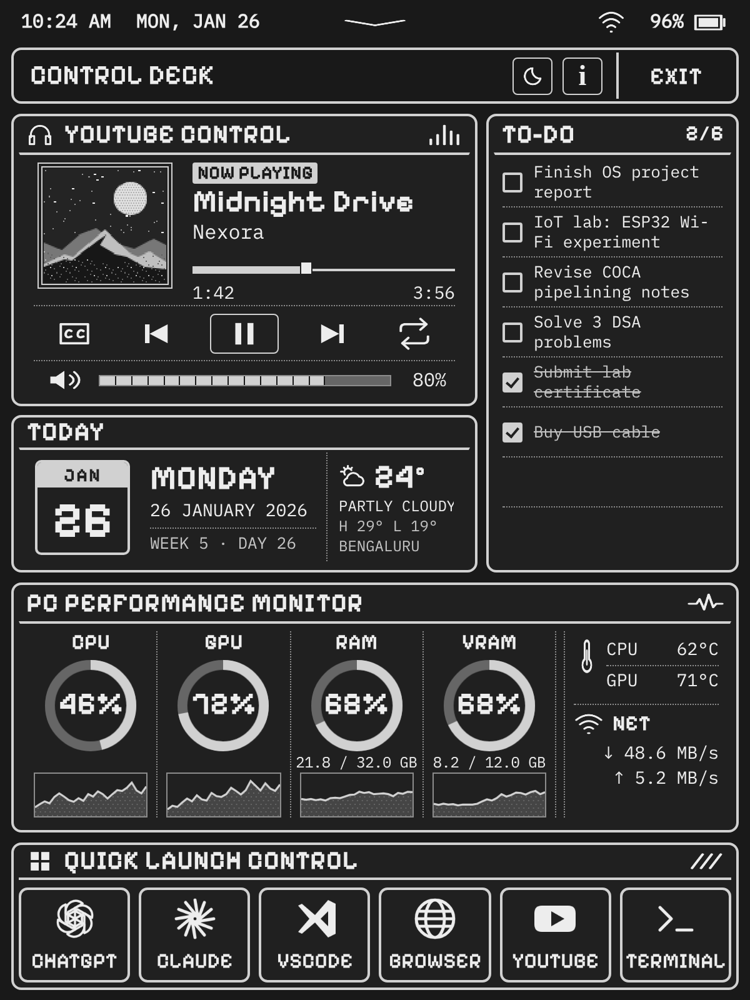

# Control Deck

> **This is a fork of [shaikshabayakati/control-deck](https://github.com/shaikshabayakati/control-deck).** All credit for the original dashboard, Kindle app, Windows companion and YouTube extension goes to its author. The original README follows below this note.
>
> **What this fork adds**
> - **Live PC Performance Monitor**: CPU, GPU, RAM, VRAM, battery and network speed from the Windows companion (`psutil`, plus `nvidia-smi` for NVIDIA GPUs), drawn as gauges and sparklines.
> - **TO-DO panel** (replaces the big clock): tasks come from `companion/todo.txt` on the PC, and tapping a task on the Kindle ticks it off in the file.
> - **TODAY panel** (replaces Codex Limits): the date, ISO week and day of the year, plus **live weather** (icon, temperature, conditions, high/low) from [Open-Meteo](https://open-meteo.com/), fetched by the PC companion. Set your city in `companion/weather-location.txt`, or leave it empty to detect it automatically.
> - **Sharp on any screen size**: everything is drawn natively at the Kindle's real resolution (fonts, lines, gauges and 2× background artwork), so it fills a Kindle Paperwhite 3 (1072×1448) without blur, and taps are mapped to match.
> - **Cleaner look and a real battery**: single-line panel frames instead of double borders, and the status bar shows the Kindle's actual battery level and charging state.
> - **One-click Windows setup** (`Setup.bat`): installs the packages, pairs over Wi-Fi and the USB cable, and copies the files to the Kindle. Pairing no longer needs OpenSSL.
> - **Ethernet over USB** for older Kindles: see the [Paperwhite 3 / USB guide](docs/paperwhite3-usb.md).

I turned a 10th-generation Kindle into a desk controller for my Windows PC. The Kindle draws the dashboard directly on its e-ink screen. Quick Launch opens apps or websites on the PC, and the browser extension sends playback commands to YouTube.

## Build guides

| Device | Starting point |
| --- | --- |
| [Old phone or tablet](docs/phone-tablet.md) | Run a macro deck in the browser of a spare Android or iOS device. |
| [ESP32 touchscreen](docs/esp32-touchscreen.md) | Flash a supported touchscreen board or build your own interface with LVGL. |
| [Kindle](docs/kindle.md) | Build and install this e-ink dashboard, Windows companion, and YouTube extension. |

## Source

- [Kindle app and scriptlet](kindle/) draw the interface, handle taps, and call the PC on the local network.
- [Windows companion](companion/) opens the Quick Launch targets. Its [browser extension](companion/youtube-extension/) reads and controls the selected YouTube player.
- [Dashboard design](design/) contains the HTML, CSS, and JavaScript used to generate the Kindle artwork. Open `index.html` in a browser for a standalone preview. The preview uses sample data.
- [Earlier prototypes](legacy/) include the browser-based Kindle version, standalone native build, and Spotify companion.

The PC performance panel shows live CPU, RAM, battery and network stats from the Windows companion, plus GPU and VRAM on PCs with an NVIDIA GPU. The TO-DO panel shows tasks from `companion/todo.txt` on the PC; tap a task on the Kindle to tick it off. The TODAY panel shows the date. To change the layout, edit the design and regenerate the backdrops. [Backdrop instructions](docs/kindle.md#customize-the-artwork)
